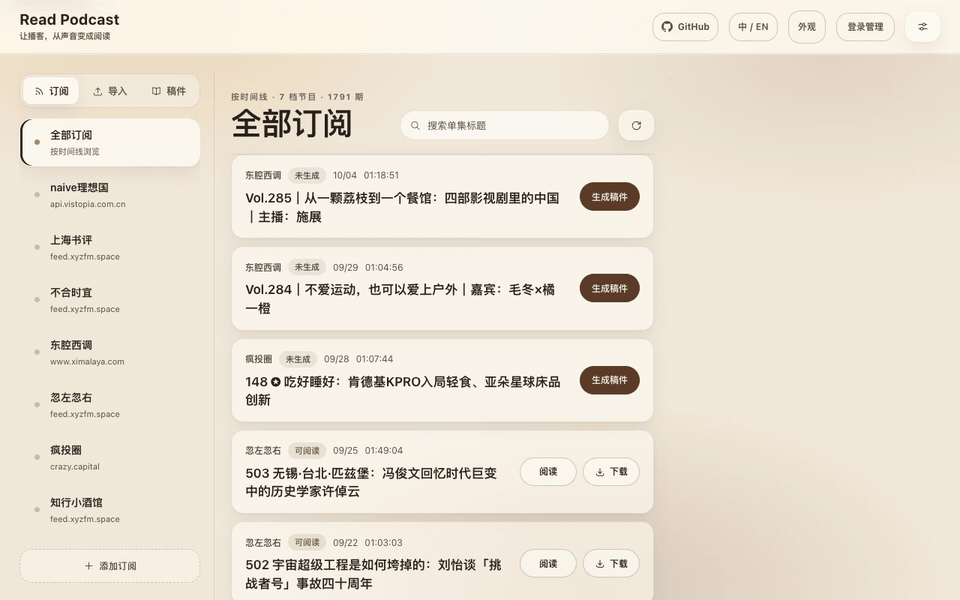
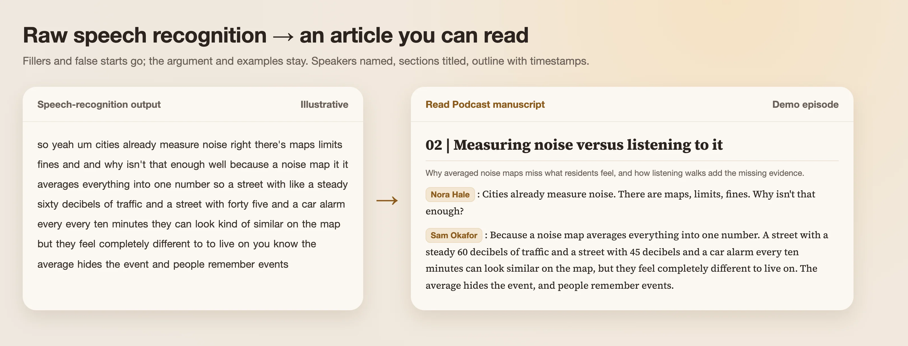
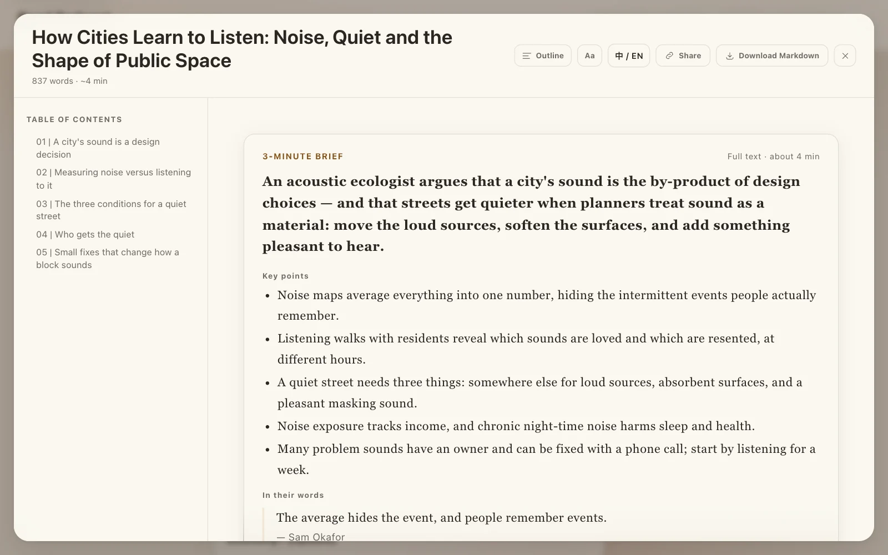
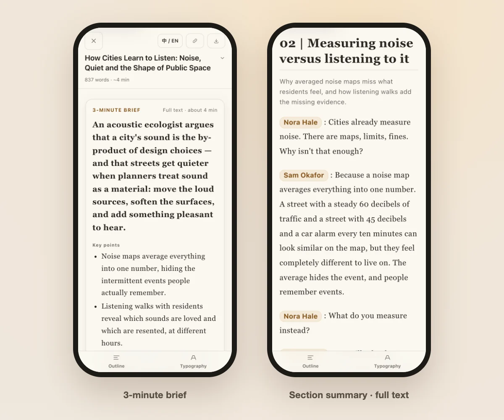
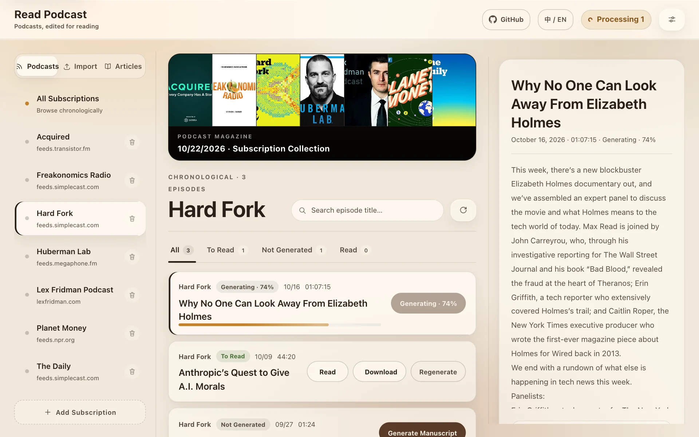

# Read Podcast

**English** · [简体中文](README.zh-CN.md)

**Read the podcasts you don't have time to re-listen to.** Read Podcast turns the episodes you pick into a three-minute brief plus the full conversation, edited like a magazine interview — speakers named, sections titled, timestamps kept — and saves every piece as Markdown in storage you own.

[](https://github.com/xielevi/read-podcast/actions/workflows/ci.yml)
[](LICENSE)
[](docs/DEPLOYMENT.md#2-cloudflare-application)
[](docs/DEPLOYMENT.md#7-local-docker-deployment)

**[Live demo → read-podcast.xielevi.cc](https://read-podcast.xielevi.cc)** · [How it works](#how-it-works) · [Quick start](#quick-start) · [How it compares](#how-it-compares)

<p align="center">
  
</p>

## Why

You finish a two-hour conversation that was worth every minute. A week later you want the one argument that made it worth it, and the only way back is to scrub through audio. Show notes list topics; AI recaps squeeze two hours into a few bullet points. The conclusions survive, the reasoning and examples do not.

Read Podcast keeps the conversation itself. It transcribes the episode you pick, then edits it the way a magazine edits an interview: verbal repetition goes, the arguments, evidence and back-and-forth stay. You get an article you can skim in three minutes, read in full, search, quote and keep.

## Who it's for

- **Heavy listeners** of long-form interview shows — business, science, history, tech — who want to return to an argument without re-listening.
- **Researchers, writers and students** who quote podcasts and need accurate, attributable text.
- **Note-takers** who keep a Markdown vault (Obsidian, a Git repository) and want episodes in it as real documents.
- **Self-hosters** who prefer their own deployment and their own model keys to another subscription.

It is a single-owner workspace for personal or small private deployments, not a multi-user service.

## How it works

1. **Subscribe** — search Apple Podcasts or paste any RSS feed. You can also upload your own audio.
2. **Transcribe** — pick an episode and press *Generate*. Transcription runs on your own Whisper service (MLX on Apple Silicon, Faster-Whisper in Docker) or a cloud provider.
3. **Refine** — any OpenAI-compatible LLM edits the transcript into a long-form manuscript, with prompts written for the episode's language: English episodes get English instructions and come back as natural English, Chinese episodes as Chinese.
4. **Read** — open the three-minute brief, skim the one-line summary under each section, then read the full text in a reader built for long articles, on desktop or phone. Every manuscript is also a Markdown file you own.

## Before and after

<p align="center">
  
</p>

What speech recognition gives you *(illustrative — typical unedited ASR output, written for this README)*:

```text
so yeah um cities already measure noise right there's maps limits fines and and why
isn't that enough well because a noise map it it averages everything into one number
so a street with like a steady sixty decibels of traffic and a street with forty five
and a car alarm every every ten minutes they can look kind of similar on the map
```

What Read Podcast publishes *(from the demo episode in the screenshots — an original, fictional conversation written for this README)*:

```markdown
## 02 | Measuring noise versus listening to it

**Nora Hale**: Cities already measure noise. There are maps, limits, fines. Why isn't that enough?

**Sam Okafor**: Because a noise map averages everything into one number. A street with a steady
60 decibels of traffic and a street with 45 decibels and a car alarm every ten minutes can look
similar on the map, but they feel completely different to live on.
```

Length is checked, not hoped for: by default a draft shorter than 70% of the transcript fails the quality gate and is not published. On the live demo, a 63-minute episode ([忽左忽右 #502](https://read-podcast.xielevi.cc/a/26b88d3a-3b60-430d-b709-7d36ed52e741)) became a manuscript of about 17,000 characters: a timestamped outline, six titled sections and both speakers named.

## Brief first, full text when you want it

Every manuscript opens with a three-minute brief: the main conclusion, key points, verbatim quotes and who should read on. Each section starts with a one-line summary, so you can skim the structure and dive into the parts that matter. On a phone it reads the same way.

<p align="center">
  
</p>

<p align="center">
  
</p>

## Sample manuscripts

Read full results on the live demo, the maintainer's own instance, open read-only to visitors (generating new manuscripts requires your own deployment). The demo library is Chinese-language; switch the interface to English with the **中 / EN** button:

- [宇宙超级工程是如何垮掉的：刘怡谈「挑战者号」事故四十周年](https://read-podcast.xielevi.cc/a/26b88d3a-3b60-430d-b709-7d36ed52e741) — 忽左忽右 · 63 min · two speakers, 6 sections
- [袁长庚×胡安焉：脏活与狗屁工作，谁在工位追问意义？](https://read-podcast.xielevi.cc/a/8c2652d0-99b6-4985-9c65-9e5ba766b7e6) — 上海书评 · 80 min · three speakers, 11 sections
- [对话经济学家朱宁：1929之后，我们学会避免下一场经济危机了吗？](https://read-podcast.xielevi.cc/a/6a85212f-236c-577d-a554-a8375452e068) — 知行小酒馆 · 73 min · two speakers, 12 sections

<p align="center">
  
</p>

*Screenshots come from a local instance subscribed to public English podcast feeds (show names, artwork and episode titles from their RSS). The readable articles in the screenshots are placeholders, and the featured episode is fictional; no real transcript is reproduced.*

## Features

- **Subscribe or import** — find shows on Apple Podcasts, paste any RSS URL, or upload your own audio (up to 200 MiB).
- **You choose what gets processed** — generation starts per episode; new episodes are never processed automatically. Close the browser and the job keeps running.
- **Long-form editing, not summarising** — speaker labels (real names when the show notes give them), titled sections and a timestamped outline; repetition removed, arguments and examples kept. Custom editorial instructions take precedence.
- **Three-minute brief first** — each new manuscript gets a best-effort brief (TL;DR, key points, verbatim quotes, who should read on, reading time) and a one-line summary under each section, so you can decide before committing to the full text.
- **A reader built for long text** — outline navigation, reading settings, and key concepts linked to Wikipedia in the reader's language.
- **English and Chinese** — the UI follows your browser language and remembers a manual switch; editing, brief and section-summary prompts follow the episode's spoken language, so English shows produce English manuscripts.
- **Markdown you own** — each manuscript is a Markdown file with YAML front matter in your GitHub repository (Cloudflare) or a local folder ready for Obsidian (Docker). Download any piece from the reader.
- **Public read-only browsing** — visitors at `/` can browse subscriptions and published manuscripts; everything that changes state lives under `/manage`.
- **Shareable and followable** — every manuscript has a permanent link at `/a/<id>` with link previews; `/feed.xml` is an Atom feed of new manuscripts with their briefs, for any feed reader.
- **Self-hosted, bring your own models** — Cloudflare Workers or a single Docker host; transcription with local Whisper (MLX on Apple Silicon, Faster-Whisper in Docker), an OpenAI-compatible upload proxy, or DashScope; editing with any OpenAI-compatible LLM API.

## How it compares

A category-level comparison; individual products vary.

| | Podcast-app AI summaries | Transcription services | Highlight / note apps | **Read Podcast** |
|---|---|---|---|---|
| What you get | A short recap or chapter notes | A verbatim transcript | Clips and notes on moments you mark | An edited, full-length manuscript |
| Fidelity to the argument | Conclusions, little reasoning | Everything, including fillers and false starts | Only what you highlighted | Reasoning and examples kept; ≥ 70% of transcript length by default |
| Where your text lives | Inside the app | Files you export | In the app, with exports | Markdown in your GitHub repository or local folder |
| Self-hostable | No | Usually hosted only | Typically no | Yes — Cloudflare or Docker, MIT licensed |
| Cost model | Bundled with the app or its subscription | Per minute or subscription | Freemium or subscription | Your hosting plus your LLM usage; local transcription has no API fees |
| Setup | None | None | None | You deploy it and bring an LLM API key |

## Quick start

### Docker — the fastest path

You need Docker and an API key for any OpenAI-compatible LLM. Transcription runs locally in the bundled Faster-Whisper container, and manuscripts land in `./manuscripts`.

```bash
git clone https://github.com/xielevi/read-podcast.git && cd read-podcast
cp .env.example .env              # set REFINER_API_KEY
docker compose up -d
```

Open `http://127.0.0.1:3000/manage` and set your provider's API base and model under **Settings → Advanced**. Ports are bound to localhost; set `CONTROL_AUTH_USER` / `CONTROL_AUTH_PASSWORD` before exposing the host. Details: [Docker guide](docs/DEPLOYMENT.md#7-local-docker-deployment).

### Cloudflare — an edge-hosted reading site

Runs on Workers, D1, Workflows and R2, and publishes manuscripts to your own GitHub repository. You need a domain on Cloudflare, a transcription backend (your own [Transcription Service](docs/DEPLOYMENT.md#3-transcription-service) behind a Tunnel, or [DashScope](docs/DEPLOYMENT.md#4-cloud-transcription-dashscope-paraformer)) and an LLM API key.

```bash
npm install
npm run setup                     # idempotent: creates D1/R2, prompts for secrets, prints the Access checklist
```

Then follow the [Cloudflare guide](docs/DEPLOYMENT.md#2-cloudflare-application) for Access, the Tunnel and deployment. A one-click **Deploy to Cloudflare** template is in review; the button will be added here only after a fresh-account deployment has been verified ([remaining checks](docs/DEPLOYMENT.md#deploy-to-cloudflare-template-one-click-deployment)).

The maintainer runs the Cloudflare application on Workers Free, but that does not establish spare CPU, subrequest or Workflow capacity for every workload. Check the [Free-plan limits](docs/DEPLOYMENT.md#resource-names-and-free-plan-boundary-checks) against your usage. LLM and cloud transcription providers may charge separately.

### Security boundary

This is a single-owner workspace. Reading at `/` is public by default; protect the whole hostname if subscriptions and manuscripts should be private. On Cloudflare, `/manage*` and `/api/control/*` **must** be protected by Cloudflare Access on a custom domain or Basic Auth on workers.dev; without Basic Auth credentials, a workers.dev control plane refuses every request. Docker binds to localhost by default, with optional Basic Auth. See [Deployment](docs/DEPLOYMENT.md) and [Security](.github/SECURITY.md).

## Roadmap

In development, not yet released:

- **Deploy to Cloudflare button** — pending fresh-account validation.

## Documentation

- [Deployment](docs/DEPLOYMENT.md) — setup, credentials, security boundaries, smoke tests and Free-plan limits
- [Architecture](docs/ARCHITECTURE.md) — task lifecycle, checkpoints and manuscript storage
- [Upgrading](docs/UPGRADING.md) — backups and schema migrations
- [Changelog](CHANGELOG.md)

## Contributing

Issues and pull requests are welcome. Start with the [contributing guide](.github/CONTRIBUTING.md), and report vulnerabilities through the [security policy](.github/SECURITY.md). To work on the Worker locally:

```bash
npm install
cp .dev.vars.example .dev.vars
npm run db:migrate:local
npm run dev                       # http://localhost:8787; owner view at /manage
```

Local development has no Access gate. To generate a manuscript you also need a transcription service, an LLM key and a GitHub manuscript repository configured in `.dev.vars`; the example points to a local transcription service at `http://127.0.0.1:28100`.

If Read Podcast saves you a re-listen, **a ⭐ on GitHub** helps other people find it.

The earlier Python/macOS desktop app is archived on [`legacy/python`](https://github.com/xielevi/read-podcast/tree/legacy/python); v1.0 is the TypeScript browser application with Cloudflare and Docker deployments. [MIT license](LICENSE).
